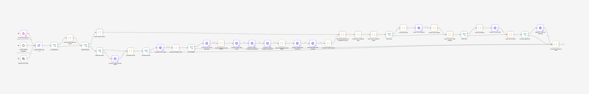

<div align="center">

# n8n-hubspot-support-ticket-frustration-slack-escalation

**Customer success automation that scans incoming support ticket replies for sentiment regression and frustration keywords, instantly opening high-priority internal Slack alerts.**

A dhRobin Systems Revenue Infrastructure blueprint

     

</div>

---

## Table of Contents

1. [Overview](#1-overview)
2. [Architecture and Data Flow](#2-architecture-and-data-flow)
3. [Repository Contents](#3-repository-contents)
4. [Prerequisites](#4-prerequisites)
5. [5-Minute Sandbox Quick Start](#5-5-minute-sandbox-quick-start)
6. [Step-by-Step Import and Configuration Guide](#6-step-by-step-import-and-configuration-guide)
7. [Environment Variables](#7-environment-variables)
8. [Node-by-Node Configuration Guide](#8-node-by-node-configuration-guide)
9. [Frustration Scoring Model, Regression Logic and False-Positive Protections](#9-frustration-scoring-model-regression-logic-and-false-positive-protections)
10. [Safety Matrix](#10-safety-matrix)
11. [Data Protection and Compliance Checklist](#11-data-protection-and-compliance-checklist)
12. [Operations and Troubleshooting](#12-operations-and-troubleshooting)
13. [Disclaimer and License](#13-disclaimer-and-license)

---

## 1. Overview

The reply that says "third time this month… our lawyer is reviewing the contract" usually lands in a queue behind forty password resets. By the time a team lead reads it, the customer has already started talking to a competitor.

I built this workflow to get that reply in front of a person within a minute. When a customer replies on a HubSpot help desk ticket, it reads the conversation thread and keeps only genuine customer messages, discarding agent notes, agent replies, out-of-office and bounce messages, and internal senders. It then scores the newest message for frustration and churn risk, compares it with the ticket's previous sentiment, and posts a high-priority Slack alert when the score crosses your threshold or sentiment regresses sharply. It can also flag the ticket in HubSpot.

**Outputs per scored ticket**

| Field | Meaning |
|---|---|
| `frustration_score` | 0–100 |
| `severity_tier` | `critical`, `high`, `moderate`, `low` |
| `matched_triggers[]` | e.g. `legal: lawyer`, `churn: intends to cancel/leave`, `repeated_follow_up: 3 customer messages without an agent reply` |
| `sentiment_delta` | Current score minus the baseline (previous stored score, or earlier customer messages) |
| `is_regression` | Delta ≥ `REGRESSION_DELTA` and score ≥ `REGRESSION_MIN_SCORE` |
| `should_escalate` | Tier ≥ `ESCALATE_MIN_TIER`, or a regression at moderate or above (before the cooldown) |

**Design principles**

| Principle | Implementation |
|---|---|
| Safe by default | With no environment variables set, the workflow makes **zero HubSpot calls, zero Slack calls and zero writes**. Alerts need `SEND_SLACK_ALERTS=true`, ticket flags need `WRITE_TO_HUBSPOT=true`, and both also need `SANDBOX_MODE=false` and `DRY_RUN=false`. |
| Deterministic and explainable | No AI model. Every point of a score comes from a named trigger shown in the alert, so a support lead can see why it fired. |
| Customer voice only | Internal comments, agent replies, auto-replies, bounces and internal-domain senders never score. |
| No alert spam | A per-ticket cooldown (ticket property and workflow memory) suppresses repeats. Only a higher severity tier breaks through. Alerts are capped per run. |
| Minimum data in Slack | The preview is truncated, with emails, phone numbers and long digit runs masked. Contact names appear only with `SHOW_CONTACT_NAME=true`. |
| Secrets out of data | The HubSpot token and Slack URLs appear only as `{{ $env.* }}` in HTTP header and URL fields. The one documented exception is the webhook signing secret ([§8.2](#82-parse--verify-webhook-events)). |

---

## 2. Architecture and Data Flow

```mermaid
flowchart LR
    WH[Ticket Reply Webhook<br/>conversation.newMessage · ticket.*] --> CFG
    PO[Polling Fallback Schedule<br/>every 10 min] --> CFG
    MAN[Manual Test Trigger] --> CFG[Config & Safety Gate]
    CFG --> FW{From Webhook?}
    FW -- yes --> PV[Parse & Verify Webhook Events<br/>v3 signature · loop guard] --> SB
    FW -- no --> SB{Sandbox Mode?}
    SB -- yes --> MOCK[Mock Ticket Context<br/>sample-payloads/hubspot-ticket-replies.json]
    SB -- no --> WI{Webhook Items?}
    WI -- no --> SR[HubSpot: Search Recent Tickets] --> BW
    WI -- yes --> BW[Build Work Items]
    BW --> FT[HubSpot: Find Thread] --> RT[Resolve Thread & Ticket] --> GM[HubSpot: Get Thread Messages]
    GM --> CMR[Collect Messages & Build Reads] --> BRT[Batch Read Tickets] --> AC[Ticket → Company] --> AP[Ticket → Contact] --> BCC[Build Company & Contact Reads] --> BRC[Batch Read Companies] --> BRP[Batch Read Contacts] --> ASM[Assemble Ticket Context]
    MOCK --> SCO
    ASM --> SCO[Sentiment Regression &<br/>Frustration Scoring]
    SCO --> CD[Cooldown & Escalation Gate] --> SLB[Build Slack Escalation Alerts]
    SLB --> SG{Slack Gate}
    SG -- yes --> ES[Emit Slack Alerts] --> SP[Slack: Post Escalation] --> CSR[Collect Slack Results] --> FL
    SG -- no --> FL[Build HubSpot Ticket Updates]
    FL --> WG{Write Gate}
    WG -- yes --> EF[Emit Flag Batches] --> HF[HubSpot: Flag Tickets] --> SUM
    WG -- no --> SUM[Build Run Summary]
    SUM --> SW{Summary Webhook?}
    SW -- yes --> WS[Webhook: Post Run Summary] --> AUD
    SW -- no --> AUD[Execution Summary & Audit]
```





### Stage contracts

| Stage | Output shape |
|---|---|
| Parse & Verify Webhook Events | `{ signature, received, items[{ ticketId, threadId, messageId }], ignored[] }` |
| Mock Ticket Context / Assemble Ticket Context | `{ source, sinceIso, tickets: [{ ticketId, threadId, eventMessageId, ticket{ properties }, company{ name, tier }, contact{ name, email }, messages[] }] }` |
| Sentiment Regression & Frustration Scoring | `{ counts, results: [{ ticketId, scored, skipReason, frustration_score, severity_tier, matched_triggers[], negated_triggers[], sentiment_baseline, baseline_source, sentiment_delta, is_regression, consecutive_follow_ups, should_escalate, preview, ignoredMessages[] }] }` |
| Cooldown & Escalation Gate | Same, plus `escalations[]` and `suppressed[{ ticketId, reason }]` |
| Build Slack Escalation Alerts | Same, plus `alerts[{ ticketId, tier, body }]` and `slackAllowed` |
| Build HubSpot Ticket Updates | `{ updates[{ id, properties }], batches[], fired[], writeAllowed }` |
| Execution Summary & Audit | Outcome, safety flags, thresholds, webhook stats, per-ticket score, tier, triggers and ignored-message reasons (no message text), escalations, suppressions, Slack and HubSpot results |

---

## 3. Repository Contents

```
n8n-hubspot-support-ticket-frustration-slack-escalation/
├── README.md                              Technical documentation (this file)
├── workflow.json                          Importable n8n workflow with sticky notes and pinned synthetic payloads
├── DISCLAIMER.md                          Liability limitation and usage terms
├── LICENSE                                MIT License
└── sample-payloads/
    └── hubspot-ticket-replies.json        13 synthetic tickets with threads (also embedded in the sandbox node)
```

All people, companies, emails (`@example.com`, `@company.example`) and IDs are fictitious. The one phone number uses the fictional `555-01xx` range.

---

## 4. Prerequisites

| Requirement | Detail |
|---|---|
| n8n | Self-hosted **1.60 or later** (Webhook 2, Schedule Trigger 1.2, Set 3.4, IF 2, Code 2, HTTP Request 4.2, `$('Node').isExecuted`, `v1` execution order). |
| Env access | `N8N_BLOCK_ENV_ACCESS_IN_NODE=false`, so `{{ $env.* }}` expressions resolve. |
| Crypto in Code nodes | `NODE_FUNCTION_ALLOW_BUILTIN=crypto` for webhook signature verification. |
| HubSpot private app scopes | **`crm.objects.tickets.read`**, **`crm.objects.tickets.write`** (only when `WRITE_TO_HUBSPOT=true`), **`crm.objects.companies.read`**, **`crm.objects.contacts.read`**, and **`conversations.read`**, needed to read the reply text from help desk / inbox threads. |
| HubSpot ticket properties | Create these if you enable write-back: `frustration_score` (number), `frustration_escalation_flag` (single checkbox or text), `frustration_last_alert_at` (date-time or text), `frustration_last_alert_tier` (single-line text). The company tier is read from `customer_tier` (`COMPANY_TIER_PROPERTY`). |
| HubSpot developer app (real-time trigger) | Webhook subscriptions for `conversation.newMessage` and/or `ticket.propertyChange`, pointing at the n8n webhook URL. The app's client secret verifies signatures. Alternatively, a HubSpot ticket workflow can call the webhook with `{ "ticketId": "…" }`. |
| Slack | An incoming webhook URL for the escalation channel. |

> **n8n Cloud:** you can't define your own environment variables there, and Code nodes can't load `crypto`. Replace `$env.X` with `$vars.X` (on plans with Variables), and use the polling fallback or a workflow webhook with `REQUIRE_HUBSPOT_SIGNATURE=false` behind another protection layer.

---

## 5. 5-Minute Sandbox Quick Start

1. **Run n8n locally:**
   ```bash
   docker run -it --rm -p 5678:5678 \
     -e N8N_BLOCK_ENV_ACCESS_IN_NODE=false \
     -e NODE_FUNCTION_ALLOW_BUILTIN=crypto \
     -e GENERIC_TIMEZONE=UTC \
     -v n8n_data:/home/node/.n8n \
     docker.n8n.io/n8nio/n8n
   ```
2. **Import** `workflow.json` (*Workflows → Import from File*).
3. Click **Test workflow** on *Manual Test Trigger*.
4. Open **Sentiment Regression & Frustration Scoring**, **Cooldown & Escalation Gate**, **Build Slack Escalation Alerts** and **Execution Summary & Audit**.

**Expected sandbox result** (13 synthetic tickets, nothing sent or written):

| Ticket | Scenario | Score · tier | Result |
|---|---|---|---|
| `8001201` Acme Cloud Solutions | "UNACCEPTABLE… third time… broken again… we will cancel… our lawyer…!!!" | 100 · critical, Δ +84 | 🔴 **Escalate** |
| `8001202` Northstar Logistics | Three unanswered follow-ups ending "Still waiting… keep asking… escalate this to a manager" | 61 · high, Δ +56 | 🟠 **Escalate** |
| `8001211` Pinecrest Dental | "WHY IS THE DASHBOARD DOWN AGAIN?!?! … RIGHT NOW!!!" (all caps) | 61 · high | 🟠 **Escalate** |
| `8001207` Rotterdam Freight | "switching to another vendor… refund" | 56 · high (churn floor) | 🟠 **Escalate** |
| `8001213` Tokyo Robotics | "getting frustrated… supposed to be fixed… still not working"; stored score was 10 | 39 · moderate, Δ +29 | 🟡 **Escalate** (regression) |
| `8001208` Andes Mining | "broken again… unacceptable… escalated to your manager" | 61 · high | ⏸️ Suppressed: alerted 2 h ago at the same tier |
| `8001206` Kiwi Orchard | "Thanks so much, that fixed it!" (stored score 48) | 0 · low, Δ −48 | No alert |
| `8001209` Milano Tessile | "No need to escalate, and we're not going to cancel anything" | 0 · low | No alert (negated) |
| `8001203` Bavaria Precision Engineering | Neutral API question | 0 · low | No alert |
| `8001204` Harbor Freightways | Neutral customer message + internal note "customer sounded furious, might cancel" | 0 · low | Note ignored |
| `8001205` Lumiere Optique | Out-of-office auto-reply mentioning "urgent" and "unacceptable" | — | Skipped: `auto_reply` |
| `8001210` Summit Legal Partners | Mailer-daemon bounce | — | Skipped: `bounce_or_system` |
| `8001212` Orion Data | Colleague from `company.example` writing "please escalate… threatening to cancel" | — | Skipped: `internal_sender` |

Outcome `escalations_found_sandbox`: 5 Slack alerts built, 1 suppression, and 10 ticket updates prepared (score for every scored ticket, flags for the 5 escalations).

---

## 6. Step-by-Step Import and Configuration Guide

Each step changes one thing and has an exit check.

| Step | Configuration | Exit check |
|---|---|---|
| **1. Import and sandbox** | Defaults | The table in [§5](#5-5-minute-sandbox-quick-start) is reproduced. |
| **2. Tune on your language** | `FRUSTRATION_SCORE_THRESHOLD`, `ESCALATE_MIN_TIER`, `KEYWORD_WEIGHTS`, `EXTRA_KEYWORDS`, `INTERNAL_EMAIL_DOMAINS` | Edit messages in *Mock Ticket Context* with phrases your customers use. Escalations match what your team would escalate. |
| **3. Pinned live path** | `SANDBOX_MODE=false`, `REQUIRE_HUBSPOT_SIGNATURE=false`, `HUBSPOT_APP_ID=5500001`, `HUBSPOT_ACCESS_TOKEN=synthetic`, `INTERNAL_EMAIL_DOMAINS=company.example`, `DRY_RUN=false`, `SEND_SLACK_ALERTS=true`, `WRITE_TO_HUBSPOT=true`, any `SLACK_ESCALATION_WEBHOOK_URL`, `HUBSPOT_PORTAL_ID=99000001`. Run **Test workflow** from *Ticket Reply Webhook* | Two escalations (8001201 critical, 8001202 high), two pinned Slack posts, one pinned ticket batch update, and the integration's own write event ignored. Nothing leaves n8n. |
| **4. Properties and app** | Create the ticket properties ([§4](#4-prerequisites)) and the private app with the five scopes | Token works for tickets, companies, contacts and conversations. |
| **5. Live reads, dry run** | Unpin the HubSpot read nodes (*right-click → Unpin*). Real token, `DRY_RUN=true`. Trigger from *Polling Fallback Schedule* with `POLL_LOOKBACK_MINUTES=1440` | The audit lists recent tickets with scores and ignored-message reasons. Review every `should_escalate`. |
| **6. Slack, test channel** | Unpin *Slack: Post Escalation*. `DRY_RUN=false`, `SEND_SLACK_ALERTS=true`, a test-channel webhook | Alerts render with score, triggers, redacted preview and an "Open ticket" button (`HUBSPOT_PORTAL_ID` set). |
| **7. Ticket flags** | Unpin *HubSpot: Flag Tickets*. `WRITE_TO_HUBSPOT=true` | Escalated tickets show `frustration_escalation_flag`, `frustration_last_alert_*` and HIGH priority. Every scored ticket stores `frustration_score`. |
| **8. Real-time trigger** | Subscribe the HubSpot app to `conversation.newMessage` (and optionally `ticket.propertyChange`), point it at the **production** URL, set `REQUIRE_HUBSPOT_SIGNATURE=true`, `HUBSPOT_APP_CLIENT_SECRET`, `HUBSPOT_WEBHOOK_PUBLIC_URL`, `HUBSPOT_APP_ID`, then activate | A frustrated test reply reaches Slack within seconds. The polling fallback catches anything the webhook missed. |

---

## 7. Environment Variables

All variables are optional. Unset values resolve to the safest behaviour.

### 7.1 Safety gate

| Variable | Default | Effect |
|---|---|---|
| `SANDBOX_MODE` | `true` | Synthetic tickets. No HubSpot, Slack or webhook calls. |
| `DRY_RUN` | `true` | Scoring and payloads only. No alerts, no writes. |
| `SEND_SLACK_ALERTS` | `false` | Explicit opt-in for Slack alerts (also needs `SLACK_ESCALATION_WEBHOOK_URL`). |
| `WRITE_TO_HUBSPOT` | `false` | Explicit opt-in for ticket property updates. |

### 7.2 Scoring and escalation

| Variable | Default | Effect |
|---|---|---|
| `FRUSTRATION_SCORE_THRESHOLD` | `60` | Score for tier **high**. |
| `CRITICAL_SCORE_THRESHOLD` | `80` | Score for tier **critical** (legal signals are always critical). |
| `MODERATE_SCORE_THRESHOLD` | `35` | Score for tier **moderate**. |
| `ESCALATE_MIN_TIER` | `high` | Lowest tier that escalates on its own: `moderate`, `high` or `critical`. |
| `REGRESSION_DELTA` | `20` | Score increase over the baseline that counts as regression. |
| `REGRESSION_MIN_SCORE` | `30` | Minimum score for a regression. A regression at moderate or above escalates. |
| `KEYWORD_WEIGHTS` | — | JSON override of category weights, e.g. `{"churn":40,"urgency":8}`. Categories: `legal`, `churn`, `refund`, `escalation`, `frustration`, `repetition`, `urgency`. |
| `EXTRA_KEYWORDS` | — | Pipe-separated `phrase:category` additions, e.g. `data loss:urgency|go elsewhere:churn`. |
| `INTERNAL_EMAIL_DOMAINS` | — | Comma-separated domains whose senders never score (colleagues, partners). |
| `COOLDOWN_HOURS` | `12` | No repeat alert for the same ticket in this window unless the tier rises. |
| `MAX_ALERTS_PER_RUN` | `20` | Highest scores first. The rest are reported as suppressed. |
| `MAX_TICKETS_PER_RUN` | `50` | Tickets inspected per run. |

### 7.3 Sources

| Variable | Default | Effect |
|---|---|---|
| `HUBSPOT_ACCESS_TOKEN` 🔒 | — | Private app token. |
| `HUBSPOT_API_BASE_URL` | `https://api.hubapi.com` | API base URL. |
| `POLL_LOOKBACK_MINUTES` | `20` | Polling window, and the "new message" window for polled tickets. |
| `POLL_DATE_PROPERTY` | `hs_lastmodifieddate` | Ticket date property for the polling search. |
| `CLOSED_STAGE_IDS` | — | Pipeline stage IDs excluded from polling. |
| `HUBSPOT_APP_CLIENT_SECRET` 🔒 | — | Webhook signature secret (Code node exception). |
| `REQUIRE_HUBSPOT_SIGNATURE` | `true` | Reject unsigned webhook calls outside sandbox. |
| `HUBSPOT_WEBHOOK_PUBLIC_URL` | — | Exact public URL HubSpot calls (behind proxies). |
| `HUBSPOT_APP_ID` | — | Events with this `sourceId` are ignored (loop guard). |

### 7.4 Alert content, write-back and notifications

| Variable | Default | Effect |
|---|---|---|
| `SLACK_ESCALATION_WEBHOOK_URL` 🔒 | — | Slack incoming webhook for escalations. |
| `HUBSPOT_PORTAL_ID` | — | Used to build the ticket link. No button without it. |
| `HUBSPOT_TICKET_URL_TEMPLATE` | `https://app.hubspot.com/contacts/{portalId}/record/0-5/{ticketId}` | Link template. |
| `COMPANY_TIER_PROPERTY` | `customer_tier` | Company property shown as **Tier**. |
| `INCLUDE_MESSAGE_PREVIEW` | `true` | Include the redacted, truncated preview. |
| `PREVIEW_CHARS` | `280` | Preview length. |
| `SHOW_CONTACT_NAME` | `false` | Add the contact's name under the preview. |
| `FRUSTRATION_SCORE_PROPERTY` | `frustration_score` | Stores each scored ticket's score (the next regression baseline). |
| `FLAG_PROPERTY` | `frustration_escalation_flag` | Set to `true` on escalation. |
| `LAST_ALERT_PROPERTY` | `frustration_last_alert_at` | Escalation timestamp (shared cooldown). |
| `LAST_ALERT_TIER_PROPERTY` | `frustration_last_alert_tier` | Tier of the last escalation. |
| `RAISE_PRIORITY` | `true` | Set `hs_ticket_priority` to `HIGH` for critical/high escalations. Never lowers it. |
| `ALERT_WEBHOOK_URL` 🔒 | — | Optional run summary JSON (incident tooling, data warehouse). |
| `ALERT_WEBHOOK_TOKEN` 🔒 | — | Bearer token for it. |
| `NOTIFY_ON_EVERY_RUN` | `false` | Send the run summary even without escalations. |

🔒 = secret. Inject from a secret manager, never commit.

### 7.5 Sample `.env` (staging)

```bash
# n8n runtime
N8N_BLOCK_ENV_ACCESS_IN_NODE=false
NODE_FUNCTION_ALLOW_BUILTIN=crypto

# Safety gate: live reads, alerts to a test channel, no ticket writes yet
SANDBOX_MODE=false
DRY_RUN=false
SEND_SLACK_ALERTS=true
WRITE_TO_HUBSPOT=false

# Scoring
FRUSTRATION_SCORE_THRESHOLD=60
ESCALATE_MIN_TIER=high
REGRESSION_DELTA=20
COOLDOWN_HOURS=12
INTERNAL_EMAIL_DOMAINS=company.example
EXTRA_KEYWORDS=data loss:urgency

# Sources
POLL_LOOKBACK_MINUTES=20
HUBSPOT_APP_ID=
HUBSPOT_WEBHOOK_PUBLIC_URL=

# Alert content
HUBSPOT_PORTAL_ID=
COMPANY_TIER_PROPERTY=customer_tier
SHOW_CONTACT_NAME=false

# Secrets (inject from your secret manager; never commit)
HUBSPOT_ACCESS_TOKEN=
HUBSPOT_APP_CLIENT_SECRET=
SLACK_ESCALATION_WEBHOOK_URL=
```

---

## 8. Node-by-Node Configuration Guide

### 8.1 Triggers and Config & Safety Gate

- **Ticket Reply Webhook** (`POST /webhook/hubspot/ticket-replies`) answers `200` immediately.
- **Polling Fallback Schedule** runs every 10 minutes and searches tickets whose `POLL_DATE_PROPERTY` changed within `POLL_LOOKBACK_MINUTES`. Polled tickets are scored only if their newest genuine customer message falls inside that window.
- **Config & Safety Gate** clamps thresholds, parses `KEYWORD_WEIGHTS` and `EXTRA_KEYWORDS`, validates property names, and records only whether each secret or URL is set.

### 8.2 Parse & Verify Webhook Events

Accepts HubSpot app webhook batches: `conversation.newMessage` (gives the thread ID and message ID) and `ticket.creation` / `ticket.propertyChange` (gives the ticket ID). It also accepts `{ "ticketId": "…" }` or `{ "ticketIds": [...] }` from a HubSpot ticket workflow's webhook action.

Outside sandbox, it verifies `X-HubSpot-Signature-v3`: HMAC-SHA256 over `POST + URL + body + timestamp`, base64, constant-time compare, 5-minute window. **Documented exception:** an HMAC can't be computed in an HTTP header field, so this Code node reads `HUBSPOT_APP_CLIENT_SECRET` in memory. It never outputs the secret.

**Loop guard:** events whose `sourceId` equals `HUBSPOT_APP_ID`, and property changes to this workflow's own properties, are ignored.

### 8.3 HubSpot reads (live path)

| Node | Call |
|---|---|
| HubSpot: Search Recent Tickets | `POST /crm/v3/objects/tickets/search` (polling only) |
| HubSpot: Find Thread | `GET /conversations/v3/conversations/threads/{threadId}?association=TICKET`, or `GET /conversations/v3/conversations/threads?associatedTicketId={id}&association=TICKET` |
| HubSpot: Get Thread Messages | `GET /conversations/v3/conversations/threads/{threadId}/messages?limit=100` |
| HubSpot: Batch Read Tickets | `POST /crm/v3/objects/tickets/batch/read` (subject, pipeline, stage, priority, frustration properties) |
| Ticket → Company / Contact | `POST /crm/v4/associations/tickets/{companies,contacts}/batch/read` (primary association preferred) |
| Batch Read Companies / Contacts | `POST /crm/v3/objects/{companies,contacts}/batch/read` |

For a ticket with several threads, the most recently active thread is used. Each call uses `continueRegularOutput`: a failed read leaves that context empty and is listed in the audit. Only the first page of up to 100 messages per thread is read, so in exceptionally long threads the newest replies can fall outside it. Check `truncated` in *Collect Messages & Build Reads* if a long-running ticket never scores.

### 8.4 Scoring, cooldown and alerts

- **Sentiment Regression & Frustration Scoring** implements [§9](#9-frustration-scoring-model-regression-logic-and-false-positive-protections).
- **Cooldown & Escalation Gate** checks `LAST_ALERT_PROPERTY` (if written back) and workflow memory (production runs). It suppresses alerts within `COOLDOWN_HOURS` unless the tier is higher than last time, then caps the run at `MAX_ALERTS_PER_RUN` (highest score first).
- **Build Slack Escalation Alerts** creates, per escalation:
  - a header with tier and ticket ID;
  - fields for account, tier, score, change, ticket subject, priority and stage;
  - the matched triggers;
  - the redacted preview;
  - an **Open ticket in HubSpot** button (red for critical);
  - a context line with follow-up count, cooldown bypass and message ID.
- **Slack: Post Escalation** sends one message per escalation, about one per second.

### 8.5 HubSpot ticket flagging

**Build HubSpot Ticket Updates** writes `FRUSTRATION_SCORE_PROPERTY` for every scored ticket, so the next reply has a baseline. For escalations that **fired** (Slack succeeded, or Slack isn't enabled in flag-only mode), it also writes `FLAG_PROPERTY=true`, `LAST_ALERT_PROPERTY`, `LAST_ALERT_TIER_PROPERTY` and, with `RAISE_PRIORITY`, `hs_ticket_priority=HIGH` (never lowered). **HubSpot: Flag Tickets** sends `POST /crm/v3/objects/tickets/batch/update` in batches of 100.

### 8.6 Run summary and audit

**Build Run Summary** creates `event: "hubspot.ticket_frustration.run"` with counts, escalations (ticket ID, tier, score, regression, company, trigger categories), suppressions and Slack results, without message text. It's sent to `ALERT_WEBHOOK_URL` when there were escalations or failures.

**Execution Summary & Audit** outcomes: `no_tickets`, `no_customer_messages_to_score`, `no_escalations`, `escalations_suppressed`, `escalations_found_sandbox`, `escalations_found_dry_run`, `escalations_found_slack_disabled`, `escalated`, `escalated_partially`, `escalation_failed`.

---

## 9. Frustration Scoring Model, Regression Logic and False-Positive Protections

### 9.1 Which message is scored

The newest message in the thread that passes all filters (or the exact message named by a `conversation.newMessage` event):

| Filter | Rule | Ignored as |
|---|---|---|
| Internal notes | `type` other than `MESSAGE` (help desk `COMMENT`s) | `internal_note` |
| Agent replies | `direction` other than `INCOMING` | (used only for follow-up counting) |
| Bounces / system senders | Sender address starts with `mailer-daemon@`, `postmaster@`, `no-reply@`, `noreply@`, `do-not-reply@`, `bounce@`, `notification(s)@` | `bounce_or_system` |
| Auto-replies | Subject like "Automatic reply", "Out of office", "Undeliverable", "Delivery Status Notification", or body like "I am out of the office", "This is an automated response", "could not be delivered", "mailbox is full" | `auto_reply` |
| Internal senders | Sender domain in `INTERNAL_EMAIL_DOMAINS` | `internal_sender` |
| Empty | No text | `empty` |

### 9.2 Score (0–100)

| Component | Points | Examples |
|---|---|---|
| **Legal** (tier floor: critical) | 45 | lawyer, attorney, legal action, involving our legal, sue you, lawsuit, chargeback, regulator, breach of contract |
| **Churn** (tier floor: high) | 35 | "cancel …" with subscription/account/contract/plan/service/licence/renewal/membership, "we will / I'm going to cancel/leave", not renewing, switching to, another vendor, close our account |
| **Refund** | 18 | refund, money back, credit for the downtime, compensation |
| **Escalation** | 22 | escalate, manager, supervisor, someone senior, head of support |
| **Frustration** | 20 | unacceptable, ridiculous, terrible support, fed up, furious, frustrated, waste of time, not good enough |
| **Repetition** | 16 | still waiting, still not, broken/down/failed again, third time, how many times, keep asking, nobody has responded, supposed to be fixed |
| **Urgency** | 12 | urgent, asap, immediately, right now, production down, outage, losing money, whole team is blocked |
| Extra hits in a category | +3 each (max 2) | |
| Exclamation marks | +2 per `!` after the first, +2 per `!!`/`?!` run (max 14) | |
| ALL-CAPS ratio (≥ 20 letters) | +16 at ≥ 50% of words, +6 at ≥ 25% | |
| Unanswered follow-ups | +7 per consecutive customer message beyond the first, without an agent reply (max 18) | |
| Positive language | −15 (−5 per extra phrase), **never applied when legal or churn signals are present** | thanks, appreciate, resolved, fixed it, works now |

Category weights can be changed with `KEYWORD_WEIGHTS`, and phrases added with `EXTRA_KEYWORDS`. Each category counts once at its full weight, so repeating "unacceptable" five times doesn't stack.

### 9.3 Tiers and escalation

| Tier | Rule |
|---|---|
| critical | Any legal signal, or score ≥ `CRITICAL_SCORE_THRESHOLD` (80) |
| high | Any churn signal, or score ≥ `FRUSTRATION_SCORE_THRESHOLD` (60) |
| moderate | Score ≥ `MODERATE_SCORE_THRESHOLD` (35) |
| low | Otherwise |

`should_escalate` is true when the tier is at or above `ESCALATE_MIN_TIER` (default `high`), or when the message is a regression and at least moderate.

### 9.4 Sentiment regression

- **Baseline:** the ticket's `FRUSTRATION_SCORE_PROPERTY` (written back by this workflow for every scored reply), or, if that's empty, the average score of up to three earlier customer messages in the thread.
- `sentiment_delta = frustration_score − baseline` (`null` without a baseline).
- `is_regression = sentiment_delta ≥ REGRESSION_DELTA and frustration_score ≥ REGRESSION_MIN_SCORE`.

A customer who goes from polite (10) to "getting frustrated… supposed to be fixed last week… still not working" (39) escalates as a moderate regression, before the language gets worse.

### 9.5 False-positive protections

| Protection | How |
|---|---|
| Negation | A trigger preceded within three words by no/not/never/don't/won't/no need to … is ignored ("No need to escalate", "we're not going to cancel our contract"). Complaint negations such as "isn't fixed" or "still not working" don't cancel a nearby threat. |
| Product-sense words | "cancel" counts only with an account object or stated intent, so "How do I cancel a scheduled report?" and "Please cancel the meeting invite" score 0. "Our legal team asked for the DPA" doesn't trigger the legal category. |
| Whole-phrase matching | Phrases match on word boundaries only. |
| Agent notes, auto-replies, bounces, internal senders | Never scored ([§9.1](#91-which-message-is-scored)). |
| Positive dampener | Thank-you replies move the score down, but never hide legal or churn signals. |
| Cooldown | One alert per ticket per `COOLDOWN_HOURS`, unless the tier rises. |
| Per-run cap | `MAX_ALERTS_PER_RUN`. |

> **Known limits:** keyword scoring doesn't understand sarcasm, quoted earlier messages pasted into a reply, or languages other than English. Add translated phrases with `EXTRA_KEYWORDS`. Strip quoted history in your inbox settings where possible. Review suppressed and low-scored tickets during tuning.

---

## 10. Safety Matrix

| `SANDBOX_MODE` | `DRY_RUN` | `SEND_SLACK_ALERTS` | `WRITE_TO_HUBSPOT` | HubSpot reads | Slack alerts | Ticket updates | Run summary webhook |
|:---:|:---:|:---:|:---:|:---:|:---:|:---:|:---:|
| `true` *(default)* | any | any | any | No (fixture) | No | No | No |
| `false` | `true` *(default)* | any | any | Yes | No | No | No |
| `false` | `false` | `false` *(default)* | `false` *(default)* | Yes | No | No | Yes, if URL set |
| `false` | `false` | `true` | `false` | Yes | **Yes** | No | Yes, if URL set |
| `false` | `false` | `false` | `true` | Yes | No | **Yes** (flag-only mode) | Yes, if URL set |
| `false` | `false` | `true` | `true` | Yes | **Yes** | **Yes**, for alerts that were delivered | Yes, if URL set |

**Pinned data:** pins apply only to manual executions. Webhook and scheduled production runs always call live endpoints according to this matrix. The pinned thread messages are dated, so a manual poll-path run reports `no_new_customer_message_in_window`. Use the pinned webhook path to rehearse alerts.

---

## 11. Data Protection and Compliance Checklist

Support replies contain personal data and often confidential business information.

| Data element | Read | In Slack | Written to HubSpot | In audit |
|---|:---:|:---:|:---:|:---:|
| Reply text | ✓ | Redacted, truncated preview (optional) | — | ✗ |
| Contact name / email | ✓ | Name only with `SHOW_CONTACT_NAME=true` | — | ✗ |
| Company name, tier | ✓ | ✓ | — | ✗ |
| Score, tier, triggers | — | ✓ | Score, flag, timestamp, tier | ✓ |

- [ ] **Least privilege:** the private app has exactly `crm.objects.tickets.read`, `crm.objects.companies.read`, `crm.objects.contacts.read` and `conversations.read`, plus `crm.objects.tickets.write` only if you enable write-back.
- [ ] **Slack channel** is private and limited to support and customer success staff. Retention is set to match your support data policy.
- [ ] **Transparency:** your privacy notice covers automated analysis of support messages for prioritisation. No decision about a customer is made automatically; the workflow only alerts people.
- [ ] **Previews:** keep `INCLUDE_MESSAGE_PREVIEW=true` only if Slack is approved for support content. Otherwise set it to `false`, and the alert carries triggers and the ticket link only.
- [ ] **Signed webhooks:** `REQUIRE_HUBSPOT_SIGNATURE=true` in production.
- [ ] **Execution data** contains message text. Restrict access and enable pruning (`EXECUTIONS_DATA_PRUNE=true`, a short `EXECUTIONS_DATA_MAX_AGE`).
- [ ] **Secrets** are injected from a secret manager and rotated if an execution export leaves your team.
- [ ] **Version control hygiene:** before committing an edited workflow, run:

```bash
grep -nE '(pat-[a-z0-9]{2}-[a-f0-9-]{20,}|hooks\.slack\.com/services/[A-Z0-9]+/|Bearer [A-Za-z0-9._-]{20,})' workflow.json && echo "Possible secret found" || echo "Clean"
```

---

## 12. Operations and Troubleshooting

### 12.1 Call volume

| Path | HubSpot calls per run |
|---|---|
| Webhook, n tickets | 2n (thread + messages) + 5 batch calls |
| Poll, n tickets | 1 search + 2n + 5 batch calls |
| Alerts | 1 Slack call per escalation, 1 HubSpot batch update per 100 updated tickets |

### 12.2 Troubleshooting

| Symptom | Likely cause | Fix |
|---|---|---|
| `Rejected: HubSpot v3 signature mismatch` | URL differs from what HubSpot signed | Set `HUBSPOT_WEBHOOK_PUBLIC_URL` to the exact public URL. |
| `thread_lookup_failed` / `403` on threads | Missing `conversations.read` scope | Add the scope and re-install the private app. |
| `no_conversation_thread` | Ticket created by form or API without an inbox thread | Expected. Only tickets with conversation threads are scored. |
| Every ticket `no_new_customer_message_in_window` | Poll window shorter than the gap between replies and the poll | Increase `POLL_LOOKBACK_MINUTES`, or rely on the webhook trigger. |
| Colleague messages escalate | Internal domain not configured | Add it to `INTERNAL_EMAIL_DOMAINS`. |
| Too many alerts | Thresholds too low for your customers' tone | Raise `FRUSTRATION_SCORE_THRESHOLD` or `ESCALATE_MIN_TIER`, lower `KEYWORD_WEIGHTS` for noisy categories, lengthen `COOLDOWN_HOURS`. |
| Missed frustrated replies | Phrases your customers use aren't in the dictionary | Add them with `EXTRA_KEYWORDS` (`phrase:category`). |
| No "Open ticket" button | `HUBSPOT_PORTAL_ID` unset | Set it, or customise `HUBSPOT_TICKET_URL_TEMPLATE`. |
| Batch update `400` | A configured property doesn't exist | Create the ticket properties, or clear the variable for properties you don't want. |
| Repeated alerts across n8n instances | Workflow memory is per instance | Enable `WRITE_TO_HUBSPOT` so `frustration_last_alert_at` is shared. |
| Slack `404 no_service` | Revoked incoming webhook | Create a new webhook and update `SLACK_ESCALATION_WEBHOOK_URL`. |

---

## 13. Disclaimer and License

### ⚠️ Disclaimer & Liability Limitation

**Use at your own risk.** The code, workflows, and scripts in this repository (`n8n-hubspot-support-ticket-frustration-slack-escalation`) are provided for educational and architectural demonstration purposes.

- **No Liability:** The author and dhRobin Systems accept no responsibility or liability for any direct, indirect, incidental, or consequential damages that result from using, misusing, or deploying these scripts.
- **No Warranty:** All software, n8n JSON blueprints, JavaScript modules and prompts are provided "AS IS", without warranty of any kind, express or implied. This includes, but is not limited to, warranties of merchantability, fitness for a particular purpose, and non-infringement.
- **Production Testing Required:** Always test thoroughly in an isolated staging environment, such as a HubSpot developer test account or sandbox, with `SANDBOX_MODE=true`, `DRY_RUN=true`, `SEND_SLACK_ALERTS=false` and `WRITE_TO_HUBSPOT=false` enabled, before you connect live HubSpot or Slack credentials. Treat every frustration score as a prioritisation signal that a person must review, never as a judgement about a customer.
- **Third-Party APIs & Compliance:** You alone are responsible for complying with the terms of service, rate limits, data privacy regulations (GDPR/CCPA), and security policies of HubSpot, Slack and any connected services. That includes informing customers how support messages are analysed, limiting who can see message previews in Slack, granting only the required private app scopes, securing every token and webhook URL, and reviewing every automatically flagged ticket.

The full disclaimer is also available in [DISCLAIMER.md](DISCLAIMER.md).

### License

Released under the MIT License. Copyright (c) 2026 DH Robin (dhRobin Systems). See [LICENSE](LICENSE).

---

Full text: DISCLAIMER.md · Licensed under the MIT License. License: MIT © 2026 dhRobin Systems · Provided as-is, see the disclaimer.
